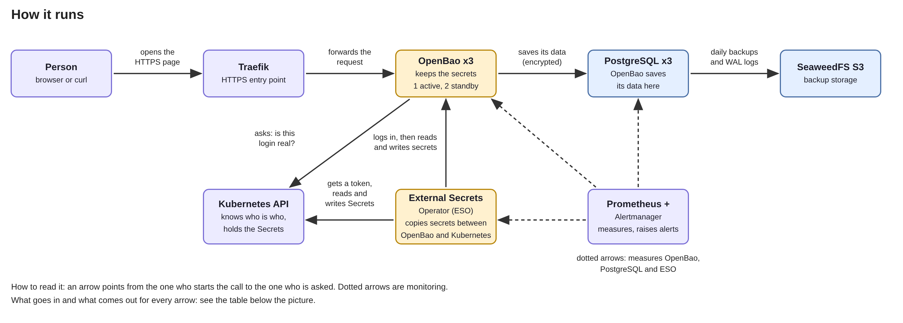

# OpenBao Platform

A Kubernetes platform that stores and hands out secrets safely. It is built
from this Git repository, has a highly available database, backups and
monitoring.

> Status: complete, failure-tested in a Codespace (kind)

## In 60 seconds

- OpenBao is the vault that keeps the secrets; it runs as 3 copies, one is active and the other two wait to take over.
- PostgreSQL is the database where OpenBao saves its data; it runs as 3 copies and is backed up every day.
- External Secrets Operator (ESO) copies secrets between OpenBao and Kubernetes, in both directions.
- Flux builds everything from this repository, so Git is the single source of truth (this way of working is called GitOps).
- Prometheus watches the platform by collecting numbers every 30 s and raises alerts when something breaks.



How to read it: an arrow points from the one who starts the call to the one who is asked. Dotted arrows are monitoring.
The table below says what goes in and what comes out.

| Who asks | Who is asked | Goes in (sends) | Comes out (gets back) |
| --- | --- | --- | --- |
| Person | Traefik, then OpenBao | An HTTPS request with an OpenBao token, e.g. "read this secret" | The secret value (1) |
| ESO | Kubernetes API | "Give me a 10-minute token for my service account" | The token |
| ESO | OpenBao | Login with that token, role `external-secrets` | An OpenBao token with the policies `default`, `eso-read` and `eso-write`, valid 15 min |
| ESO | OpenBao | Pull: read `secret/demo/hello`; push: write `secret/pushed/push-demo` | The value, or a confirmation |
| ESO | Kubernetes API | Pull: create or update the Secret `eso-demo/hello-from-openbao`; push: read the Secret `eso-demo/push-demo` | A confirmation, or the Secret value |
| OpenBao | Kubernetes API | "Is this token real?" (TokenReview) | "Yes, it is `external-secrets/external-secrets`" (2) |
| OpenBao | PostgreSQL | Its data, encrypted by OpenBao before it is saved | "Stored", or the data when OpenBao reads (3) |
| PostgreSQL | SeaweedFS (S3) | A base backup every day at 12:00 UTC and the WAL files continuously | "Stored" |
| Prometheus | OpenBao, PostgreSQL, ESO | "Give me your numbers" | A list of metrics |
| Flux | GitHub | "Fetch the repo" (every minute) | The files |
| Flux | Kubernetes API | The manifests from Git | The status of each object |

Checked against [`docs/evidence/05-external-secrets.txt`](docs/evidence/05-external-secrets.txt), [ADR 0005](docs/adr/0005-external-secrets-openbao.md)
and the repo (backup schedule in `apps/database/backups.yaml`, Flux interval in `clusters/demo/flux-system/gotk-sync.yaml`).
(1) The route is set in the repo; only `/v1/sys/health` was tested through Traefik.
(2) The login works (evidence 05); the API's answer itself was not recorded.
(3) OpenBao's own design; the evidence shows only row counts, not the stored bytes.
Words: [glossary](docs/glossary.md). Build order, certificates, network rules: [architecture](docs/architecture.md).

## Try it

Runs in a GitHub Codespace (4 cores, 16 GB) with a 4-node kind cluster, see [`docs/environment.md`](docs/environment.md).

```bash
bash scripts/bootstrap.sh            # once: kind cluster, SOPS key, Flux; Flux then builds the rest from Git
bash scripts/openbao/openbao-init.sh         # once: creates OpenBao's 5 key shares and root token, stores them safely
bash scripts/after-restart/openbao-unseal.sh       # after every restart: unlocks (unseals) every OpenBao pod with 3 shares
bash scripts/openbao/openbao-configure.sh    # once: secret storage, login for ESO, policies
bash scripts/checks/test-gate.sh            # read-only check of everything; ends with GATE PASSED
```

All other commands and the full order: [`scripts/README.md`](scripts/README.md).

## What we tested

| Test | What we broke | Result |
| --- | --- | --- |
| F1 | A worker node with the active OpenBao pod and the PostgreSQL primary | OpenBao answered again through a standby after 76 s; the restarted pod came back sealed. |
| F2 | The PostgreSQL primary pod | A replica took over after 187 s; OpenBao writes failed for only about 4-6 s. |
| F3 | All 3 OpenBao pods restarted, so they were sealed | The Kubernetes Secret kept its value, and ESO recovered by itself 16 s after the unseal. |
| F4 | The PushSecret, deleted while Flux was paused | The value was deleted in OpenBao; Flux recreated the PushSecret and the value was back 2 s after Flux resumed. |
| F5 | The ESO controller pod | A new pod logged in with new tokens and synced after 6 s; the Secret was untouched. |
| F6 | Point-in-time restore into a new cluster | The restore was exact to the target time; the cluster was healthy after 71 s. |

Details, timelines and evidence: [`docs/runbooks/failure-tests.md`](docs/runbooks/failure-tests.md).

## Production vs demo

| Topic | Demo | Production |
| --- | --- | --- |
| Unseal | Shamir: 5 key shares, threshold 3, manual `scripts/after-restart/openbao-unseal.sh` after every pod restart | Auto-unseal with a cloud KMS or an HSM |
| Unseal keys | All shares in one Codespaces secret (and `~/openbao-init.json`) | Shares split between different people, never in one place |
| Cluster | One kind cluster in one Codespace (4 node containers on one VM) | Several nodes in several zones |
| Backup storage | SeaweedFS inside the same cluster | S3 outside the cluster, in another region or account |
| TLS | Self-signed demo CA through cert-manager | Company CA or ACME |
| Root token | Used for init and configuration; still valid, revoke with `scripts/openbao/openbao-revoke-root.sh` | Break-glass only, generated when needed and revoked again |
| Access | Kubernetes auth with least-privilege policies (done) | Same |
| NetworkPolicies | Default-deny ingress in `storage`, `databases`, `openbao`, `external-secrets`, `eso-demo` (done); the metrics ports are open only to the Prometheus pod. No egress policies. No policies in the other namespaces | Ingress and egress policies in every namespace |
| Audit | OpenBao audit device to stdout (the pod log) | Audit log shipped to a log system |
| Monitoring and alerting | Prometheus and Alertmanager (1 replica each), 8 alerts (seal status, ESO sync and store, PostgreSQL health, backup age, nodes); no receiver, alerts are only visible (done) | 2 replicas, a receiver (mail/on-call), longer retention, dashboards; also certificate-expiry alerts |
| Secrets in Git | SOPS + age (done); the age key is a Codespaces secret | age key in a KMS or an external secret manager |

## Known limits

- Unseal is manual: every OpenBao pod restart needs `scripts/after-restart/openbao-unseal.sh`.
- Backups are in the same cluster, so losing the Codespace loses the data and its backups.
- Everything runs in one Codespace, so the high availability only covers failures of pods and node containers.
- Monitoring is minimal: one Prometheus, one Alertmanager, no receiver, 2 days of metrics, PostgreSQL metrics unencrypted (R30, R31).
- The OpenBao root token is still valid; revoke it with `scripts/openbao/openbao-revoke-root.sh`.
- The Flux and GitHub tokens, Codespaces secrets and deploy key must be revoked after the review ([`docs/environment.md`](docs/environment.md)).
- Nothing was load-tested.

All risks with their scores: [`docs/risk-assessment.md`](docs/risk-assessment.md).

## Go deeper

- [`docs/architecture.md`](docs/architecture.md): build order, repo map, secrets in Git, certificates, network rules, versions
- [`docs/operations.md`](docs/operations.md): daily scripts, the problem after a Codespace restart, monitoring and alerts
- [`docs/runbooks/`](docs/runbooks/): step-by-step guides (unseal, External Secrets, backup and restore, monitoring, failure tests)
- [`docs/adr/`](docs/adr/): design decisions and the options that were rejected
- [`docs/risk-assessment.md`](docs/risk-assessment.md): risks, scores and what was done about them
- [`scripts/README.md`](scripts/README.md): every script and the full start order
- [`docs/evidence/`](docs/evidence/): the real output of every test
- [`docs/glossary.md`](docs/glossary.md): every technical word in plain English
- [`docs/time-log.md`](docs/time-log.md): time spent per task
