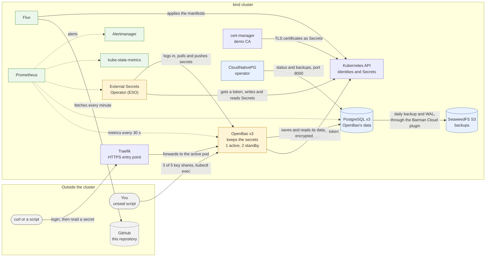

# OpenBao Platform

A Kubernetes platform that stores and hands out secrets safely. It is built
from this Git repository, has a highly available database, backups and
monitoring.

## Overview

Applications need secrets such as database passwords and API keys. If those sit in config files, in Git or in environment variables, anyone who can read those files can read the secrets, and changing one means editing every place that uses it. This platform keeps them in one place, OpenBao, where each client gets only the secrets its policy allows and access can be logged. Applications on Kubernetes receive them through External Secrets Operator as ordinary Kubernetes Secrets, so they need no OpenBao code. Because the secrets are the most sensitive data in the system, OpenBao and its database run as several copies with daily backups.

It is made of these components:

- **OpenBao** is the vault that keeps the secrets. It runs as 3 copies: one is active and the other two wait to take over.
- **PostgreSQL**, run by CloudNativePG, is the database where OpenBao saves its data. It runs as 3 copies and is backed up every day to S3 storage (SeaweedFS) inside the cluster.
- **External Secrets Operator (ESO)** copies secrets between OpenBao and Kubernetes, in both directions.
- **Traefik** is the HTTPS entry point from outside the cluster. **cert-manager** issues the TLS certificates for OpenBao, Traefik, ESO and Prometheus from one demo CA.
- **Flux** builds everything from this repository, so Git is the single source of truth (this way of working is called GitOps).
- **Prometheus** watches the platform by collecting numbers every 30 seconds, and **Alertmanager** shows the alerts when something breaks.



## How the components talk to each other?

**1. How a client reads a secret.** A client proves who it is and gets a short-lived token. It shows that token with every later request, so the login credential is sent only once.

| From | To | Request | Response |
| --- | --- | --- | --- |
| curl (or a script) | Traefik | Login: `POST /v1/auth/kubernetes/login` with a service-account token and a role | An OpenBao token |
| curl (or a script) | Traefik | Read: `GET /v1/secret/data/demo/hello` with the token in the `X-Vault-Token` header | The secret `demo/hello` as JSON |
| Traefik | OpenBao (HTTPS, port 8200) | Forwards the request to the active pod, after checking its certificate against the demo CA | The answer, passed back to the client |

**2. How secrets get into Kubernetes.** Applications do not talk to OpenBao themselves; External Secrets Operator (ESO) does it for them. ESO proves its identity with a token from the Kubernetes API, and OpenBao checks that token with the same API before it trusts ESO. After that, ESO copies secrets in both directions.

| From | To | Request | Response |
| --- | --- | --- | --- |
| ESO | Kubernetes API | Asks for a token for its service account (its identity in Kubernetes), valid 10 minutes | The signed token |
| ESO | OpenBao (HTTPS, port 8200) | Login with that token and the role `external-secrets` | An OpenBao token with the policies `default`, `eso-read`, `eso-write`, valid 15 minutes |
| OpenBao | Kubernetes API | Is this token valid, and whose is it? | Yes, it belongs to `external-secrets/external-secrets` |
| ESO | OpenBao | Pull: reads `secret/demo/hello` | The secret value |
| ESO | Kubernetes API | Pull: creates or updates the Secret `eso-demo/hello-from-openbao` | A confirmation |
| ESO | Kubernetes API | Push: reads the Secret `eso-demo/push-demo` | The Secret value |
| ESO | OpenBao | Push: writes `secret/pushed/push-demo` | A confirmation |

**3. How the data is stored and backed up.** OpenBao encrypts its data and stores it in PostgreSQL, so the database never sees a readable secret. PostgreSQL sends a full backup and its change log to S3 storage, which allows a restore to a chosen point in time.

| From | To | Request | Response |
| --- | --- | --- | --- |
| OpenBao | PostgreSQL | Saves its data, encrypted by OpenBao first | Stored |
| OpenBao | PostgreSQL | Reads its data back | The data |
| CloudNativePG operator | PostgreSQL pods (port 8000) | Asks each instance for its status and asks it to take a backup. | The status of each instance, or a confirmation of the backup |
| PostgreSQL (through the Barman Cloud plugin) | SeaweedFS (S3) | A full backup, every day at 12:00 UTC | Stored |
| PostgreSQL (through the Barman Cloud plugin) | SeaweedFS (S3) | The WAL files (PostgreSQL's log of every change), continuously | Stored |

**4. How OpenBao is unlocked and gets its certificates.** OpenBao starts locked. It needs 3 of its 5 key shares, so by design no single holder can unlock it; in this demo all shares are in one place (see [Production readiness](#production-readiness)). The TLS certificates for OpenBao, Traefik, ESO and Prometheus come from one demo CA. PostgreSQL uses a certificate from CloudNativePG's own CA.

| From | To | Request | Response |
| --- | --- | --- | --- |
| You (via `scripts/after-restart/openbao-unseal.sh`, with `kubectl exec`) | Each OpenBao pod | One key share at a time, until 3 are entered | The pod is unsealed and ready |
| cert-manager | Kubernetes API | Creates the TLS certificates, signed by the demo CA, as Secrets | The Secrets; the pods mount them, Traefik and the Prometheus Operator read them |

**5. How the platform stays correct and is watched.** Flux fetches Git every minute and applies every new commit; every 10 minutes it also corrects any difference in the cluster, so Git stays the single source of truth. Prometheus reads the numbers of each component, and Alertmanager shows an alert when a number stays wrong for too long.

| From | To | Request | Response |
| --- | --- | --- | --- |
| Flux | GitHub | Fetches the repository every minute | The files |
| Flux | Kubernetes API | Applies the manifests from Git, and decrypts the SOPS files with the age key (Secret `sops-age`) | The status of each object |
| Prometheus | OpenBao, PostgreSQL, ESO | Asks for the metrics every 30 seconds | A text list of numbers |
| Prometheus | kube-state-metrics | Asks for the state of nodes and pods | Numbers, for example whether each node is ready |
| Prometheus | Alertmanager | Sends an alert when a rule has been true long enough | Alertmanager shows it; no receiver is configured |

Words: [glossary](docs/glossary.md). Build order, certificates, network rules: [architecture](docs/architecture.md).

## Try it

Runs in a GitHub Codespace (4 cores, 16 GB) with a 4-node kind cluster, see [`docs/environment.md`](docs/environment.md).

```bash
bash scripts/setup/bootstrap.sh            # once: kind cluster, SOPS key, Flux; Flux then builds the rest from Git
bash scripts/openbao/openbao-init.sh         # once: creates OpenBao's 5 key shares and root token, stores them safely
bash scripts/after-restart/openbao-unseal.sh       # after every restart: unlocks (unseals) every OpenBao pod with 3 shares
bash scripts/openbao/openbao-configure.sh    # once: secret storage, login for ESO, policies
bash scripts/verify/test-gate.sh            # read-only check of everything; ends with GATE PASSED
```

All other commands and the full order: [`scripts/README.md`](scripts/README.md).

## What we tested?

| Test | What we broke | Result |
| --- | --- | --- |
| F1 | A worker node with the active OpenBao pod and the PostgreSQL primary | OpenBao answered again through a standby after 76 s; the restarted pod came back sealed. |
| F2 | The PostgreSQL primary pod | A replica took over after 187 s; OpenBao writes failed for only about 4-6 s. |
| F3 | All 3 OpenBao pods restarted, so they were sealed | The Kubernetes Secret kept its value, and ESO recovered by itself 16 s after the unseal. |
| F4 | The PushSecret, deleted while Flux was paused | The value was deleted in OpenBao; Flux recreated the PushSecret and the value was back 2 s after Flux resumed. |
| F5 | The ESO controller pod | A new pod logged in with new tokens and synced after 6 s; the Secret was untouched. |
| F6 | Point-in-time restore into a new cluster | The restore was exact to the target time; the cluster was healthy after 71 s. |

Details, timelines and evidence: [`docs/runbooks/failure-tests.md`](docs/runbooks/failure-tests.md).

## Production readiness

| Topic | Demo | Production |
| --- | --- | --- |
| Access | Kubernetes auth with least-privilege policies (done) | Same |
| TLS | Self-signed demo CA through cert-manager | Company CA or ACME |
| Secrets in Git | SOPS + age (done); the age key is a Codespaces secret | age key in a KMS or an external secret manager |
| Root token | Used for init and configuration; still valid, revoke with `scripts/openbao/openbao-revoke-root.sh` | Break-glass only, generated when needed and revoked again |
| NetworkPolicies | Default-deny ingress in `storage`, `databases`, `openbao`, `external-secrets`, `eso-demo` (done); the metrics ports are open only to the Prometheus pod. No egress policies. No policies in the other namespaces | Ingress and egress policies in every namespace |
| Audit | OpenBao audit device to stdout (the pod log) | Audit log shipped to a log system |
| Monitoring and alerting | Prometheus and Alertmanager (1 replica each), 8 alerts (seal status, ESO sync and store, PostgreSQL health, backup age, nodes); no receiver, alerts are only visible (done) | 2 replicas, a receiver (mail/on-call), longer retention, dashboards; also certificate-expiry alerts |
| Unseal | Shamir: 5 key shares, threshold 3, manual `scripts/after-restart/openbao-unseal.sh` after every pod restart | Auto-unseal with a cloud KMS or an HSM |
| Unseal keys | All shares in one Codespaces secret (and `~/openbao-init.json`) | Shares split between different people, never in one place |
| Backup storage | SeaweedFS inside the same cluster | S3 outside the cluster, in another region or account |
| Cluster | One kind cluster in one Codespace (4 node containers on one VM) | Several nodes in several zones |

## Known Limits

- Unseal is manual: every OpenBao pod restart needs `scripts/after-restart/openbao-unseal.sh`.
- Backups are in the same cluster, so losing the Codespace loses the data and its backups.
- Everything runs in one Codespace, so the high availability only covers failures of pods and node containers.
- Monitoring is minimal: one Prometheus, one Alertmanager, no receiver, 2 days of metrics, PostgreSQL metrics unencrypted (R30, R31).
- The OpenBao root token is still valid; revoke it with `scripts/openbao/openbao-revoke-root.sh`.
- The Flux and GitHub tokens, Codespaces secrets and deploy key must be revoked after the review ([`docs/environment.md`](docs/environment.md)).

All risks with their scores: [`docs/risk-assessment.md`](docs/risk-assessment.md).

## Further

- [`docs/architecture.md`](docs/architecture.md): build order, repo map, secrets in Git, certificates, network rules, versions
- [`docs/operations.md`](docs/operations.md): scripts to run after a restart, the problem after a Codespace restart, monitoring and alerts
- [`docs/runbooks/`](docs/runbooks/): step-by-step guides (unseal, External Secrets, backup and restore, monitoring, failure tests)
- [`docs/adr/`](docs/adr/): design decisions and the options that were rejected
- [`docs/risk-assessment.md`](docs/risk-assessment.md): risks, scores and what was done about them
- [`scripts/README.md`](scripts/README.md): every script and the full start order
- [`docs/evidence/`](docs/evidence/): the real output of every test
- [`docs/glossary.md`](docs/glossary.md): every technical word in plain English
- [`docs/time-log.md`](docs/time-log.md): time spent per task
