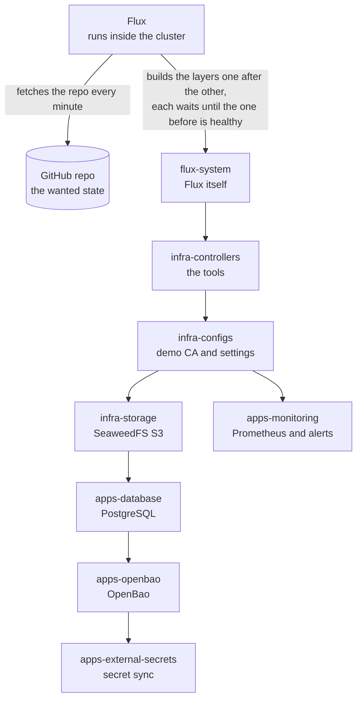
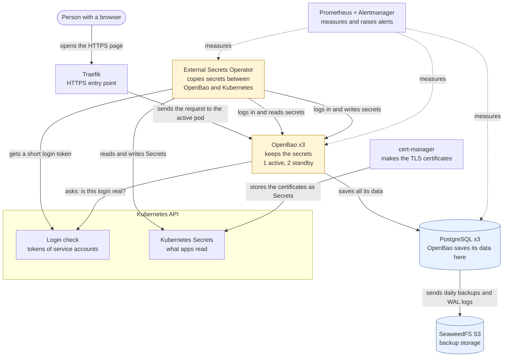
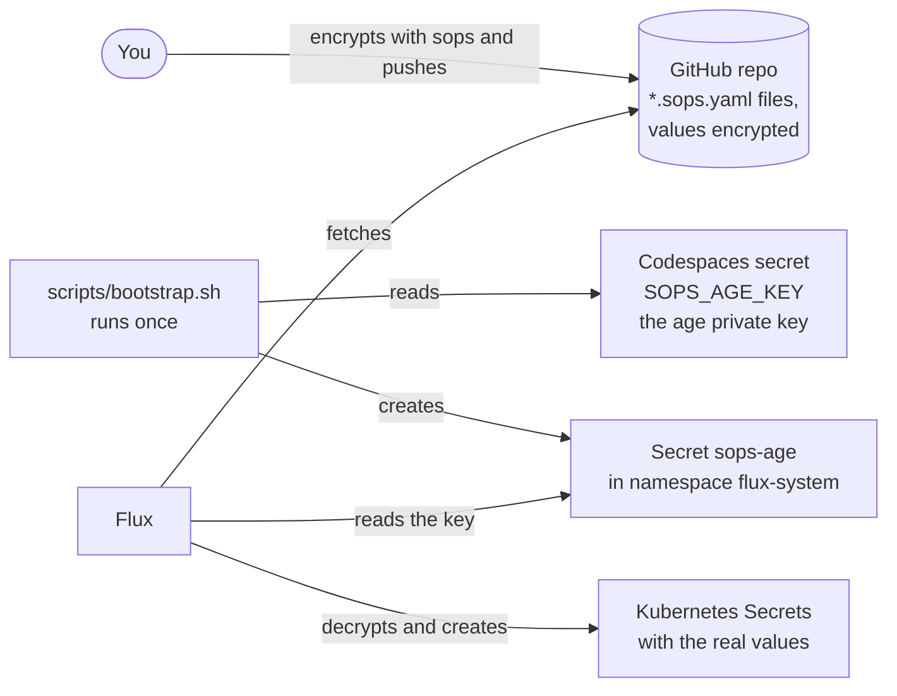
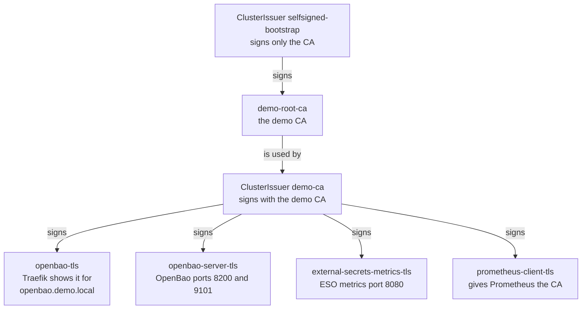
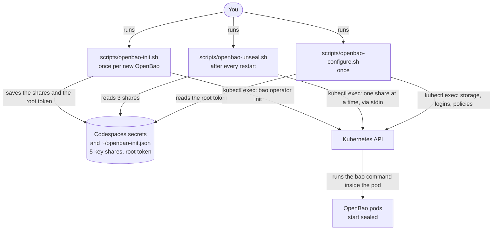
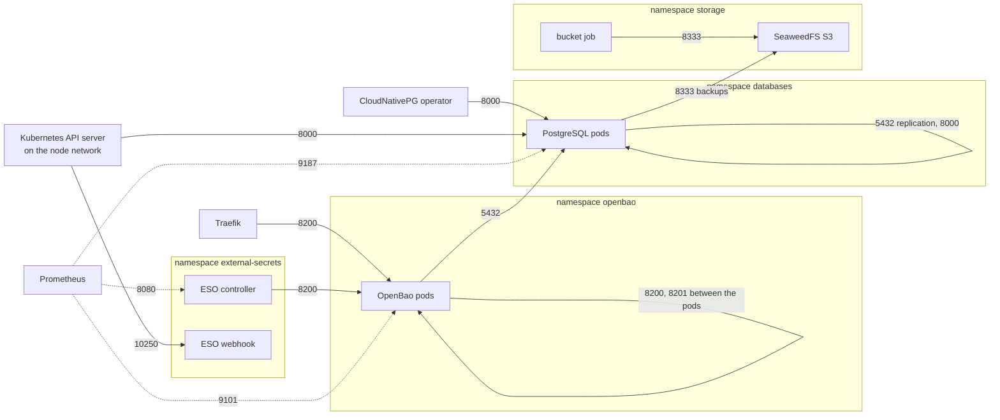
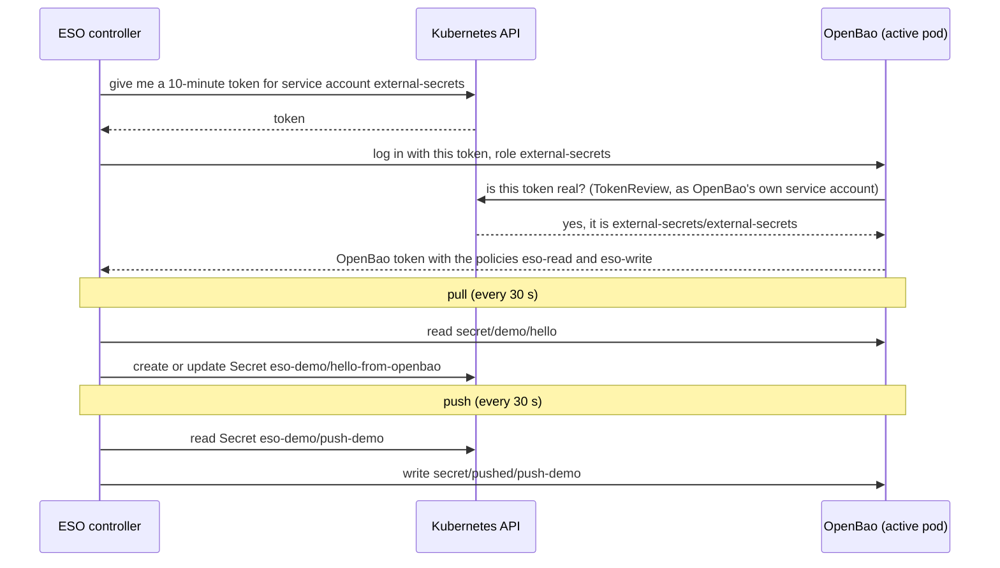
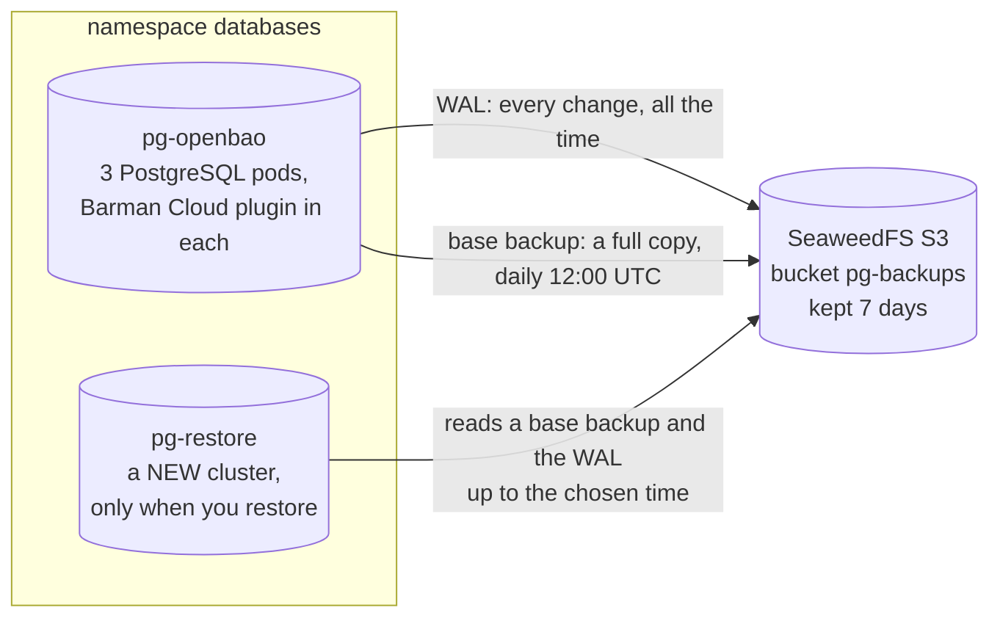

# OpenBao Platform

Production-oriented Kubernetes platform with OpenBao as the secrets management system, a highly available PostgreSQL backend, External Secrets Operator for bidirectional secret synchronization, and Flux for GitOps.

> Status: complete, failure-tested in a Codespace (kind)

## Overview

Flux applies this Git repository to the cluster in layers, each waiting for
the one before: `flux-system` → `infra-controllers` → `infra-configs` →
`infra-storage` → `apps-database` → `apps-openbao` → `apps-external-secrets`.
`apps-monitoring` (Prometheus, Alertmanager, alert rules) only waits for
`infra-controllers` and `infra-configs`. OpenBao runs as 3 pods in HA mode (one active, two standby) and stores its
data in PostgreSQL. PostgreSQL is run by CloudNativePG with 3 instances and
backs up to S3 on SeaweedFS. The External Secrets Operator syncs between
OpenBao and Kubernetes Secrets in both directions (pull and push). Traefik is
the HTTPS entry point. Prometheus scrapes OpenBao, PostgreSQL and the ESO
controller and raises alerts (sealed OpenBao, failed syncs, unhealthy
PostgreSQL, old backups, lost nodes).

### How it gets built



### How it runs



How to read it: an arrow points from the one who starts the call to the one who is asked. Dotted arrows are monitoring.
Not drawn, to keep it readable: unsealing OpenBao, the NetworkPolicies, SOPS + age for secrets in Git, and the daily backup schedule.
They are described in the sections below. Everything runs inside one kind cluster.
Also not drawn: pods do not call the Kubernetes API for their certificates; the kubelet (the Kubernetes agent on each node)
puts Secrets into the pods as files. The backups are sent by the Barman Cloud plugin, which runs inside each PostgreSQL pod.

Words used: S3 is a common way to store files over HTTP; SeaweedFS provides it
inside the cluster. WAL (write-ahead log) is PostgreSQL's running record of
every change; with the backups it allows a restore to any point in time. A
service account is the identity a pod has in Kubernetes. `apps-monitoring`
branches off after `infra-configs`: it waits only for `infra-controllers` and
`infra-configs`, not for the database, OpenBao or secret-sync layers.

### What is where in the repo

| Folder | Flux layer | What is in it |
| --- | --- | --- |
| [`clusters/demo/`](clusters/demo/) | `flux-system` | Flux itself (`flux-system/`) and the list of layers with their order (`infrastructure.yaml`, `apps.yaml`) |
| [`infrastructure/controllers/`](infrastructure/controllers/) | `infra-controllers` | The tools: cert-manager, Traefik, CloudNativePG + Barman Cloud plugin, External Secrets Operator; chart sources |
| [`infrastructure/configs/`](infrastructure/configs/) | `infra-configs` | The demo CA and its issuers, the ESO metrics certificate, one demo SOPS Secret |
| [`infrastructure/storage/`](infrastructure/storage/) | `infra-storage` | SeaweedFS (S3), the job that creates the backup bucket, the S3 keys (SOPS) |
| [`apps/database/`](apps/database/) | `apps-database` | The PostgreSQL cluster `pg-openbao`, backup target and schedule, the database password (SOPS) |
| [`apps/openbao/`](apps/openbao/) | `apps-openbao` | OpenBao (Helm), its certificates, the Traefik connection settings, the database connection string (SOPS) |
| [`apps/external-secrets/`](apps/external-secrets/) | `apps-external-secrets` | The store `openbao`, the pull and push examples in namespace `eso-demo` |
| [`apps/monitoring/`](apps/monitoring/) | `apps-monitoring` | Prometheus stack (Helm), what to scrape (PodMonitors), the alert rules |
| [`openbao/policies/`](openbao/policies/) | none | OpenBao policies; loaded by `scripts/openbao-configure.sh`, not by Flux |
| [`scripts/`](scripts/) | none | Bootstrap, OpenBao init/unseal/configure, checks, failure tests ([`scripts/README.md`](scripts/README.md)) |
| [`docs/`](docs/) | none | Design decisions (`adr/`), runbooks, test outputs (`evidence/`), risk assessment, time log |

NetworkPolicies sit next to the things they protect: `networkpolicy.yaml` in `infrastructure/storage/`,
`apps/database/`, `apps/openbao/` and `apps/external-secrets/`, and
`external-secrets-networkpolicy.yaml` in `infrastructure/controllers/`.

## Quick start

Demo environment: a GitHub Codespace (4 cores, 16 GB) running a 4-node kind cluster,
see [`docs/environment.md`](docs/environment.md).

```bash
# in a Codespace created from this repo (tools install automatically);
# secrets SOPS_AGE_KEY, FLUX_GITHUB_TOKEN, GITHUB_USER set as Codespaces secrets
bash scripts/bootstrap.sh                            # kind + SOPS key + Flux
flux get kustomizations --watch
```

OpenBao (once Flux shows `apps-openbao` Ready; details in
[`docs/runbooks/openbao-init-unseal.md`](docs/runbooks/openbao-init-unseal.md)):

```bash
bash scripts/openbao-deploy-check.sh   # 3 pods Running, sealed, tables in PostgreSQL
bash scripts/openbao-init.sh           # once: keys to ~/openbao-init.json + Codespaces secrets
bash scripts/openbao-unseal.sh         # after every pod/Codespace restart
bash scripts/openbao-configure.sh      # once: KV v2, Kubernetes auth, ESO policies and role
bash scripts/openbao-evidence.sh       # evidence in docs/evidence/04-*.txt
bash scripts/openbao-failover-test.sh  # deletes the active pod (asks first)
```

Check everything (read-only; includes monitoring: targets up, alert rules
loaded, nothing firing; details in
[`docs/runbooks/monitoring.md`](docs/runbooks/monitoring.md)):

```bash
bash scripts/test-gate.sh
bash scripts/monitoring-check.sh
```

## Components and versions

| Component | Purpose | Version |
| --- | --- | --- |
| kind | Local multi-node Kubernetes cluster | v0.33.0 |
| kind node image | Kubernetes inside each node container | `kindest/node:v1.37.0` (Kubernetes 1.37.0, kind v0.33.0 default) |
| Flux | GitOps engine | v2.9.6 |
| SOPS | Encrypted bootstrap secrets in Git | 3.13.3 |
| age | Key for SOPS | 1.1.1 (Ubuntu package) |
| cert-manager | TLS certificates (self-signed CA) | v1.21.3 |
| Traefik | HTTPS entry point (ingress) | chart 42.1.3 |
| SeaweedFS | In-cluster S3 for PostgreSQL backups | 4.48 (image) |
| CloudNativePG | HA PostgreSQL with backups | operator 1.30.1 (chart 0.29.1), PostgreSQL 18.6, plugin-barman-cloud 0.15.1 (chart 0.8.1) |
| OpenBao | Secrets management (HA, PostgreSQL backend) | 2.7.1 (chart 0.30.4) |
| External Secrets Operator | Secret sync OpenBao <-> Kubernetes | 2.14.0 (chart and app) |
| kube-prometheus-stack | Metrics and alerts: Prometheus, Alertmanager, Prometheus Operator, kube-state-metrics | chart 92.3.1 (Prometheus v3.15.0, Alertmanager v0.34.1, operator v0.94.1, kube-state-metrics 2.20.0) |

## Architecture and design decisions

All decisions are in [`docs/adr/`](docs/adr/) (ADRs 0001 to 0005 and 0007;
0006, the security-hardening decisions, is referenced in the NetworkPolicy
files but not written yet):

- [ADR 0001](docs/adr/0001-pinned-versions.md): pin exact chart and image versions.
- [ADR 0002](docs/adr/0002-in-cluster-s3.md): in-cluster S3 with SeaweedFS for PostgreSQL backups.
- [ADR 0003](docs/adr/0003-cloudnativepg-ha.md): HA PostgreSQL with CloudNativePG, backups through the Barman Cloud plugin.
- [ADR 0004](docs/adr/0004-openbao-ha-postgresql.md): OpenBao HA on PostgreSQL, manual Shamir unseal, TLS at Traefik.
- [ADR 0005](docs/adr/0005-external-secrets-openbao.md): External Secrets with one ClusterSecretStore, TLS on the OpenBao listener, Kubernetes auth, push/pull policies.
- [ADR 0007](docs/adr/0007-monitoring.md): monitoring with kube-prometheus-stack, metrics over verified TLS (OpenBao, ESO; PostgreSQL plain HTTP as a known gap), alert rules.

## How the pieces fit together

### Secrets in Git: SOPS + age

OpenBao cannot hand out the secrets it needs to start (its own database
password), so a few bootstrap secrets are stored in Git, encrypted. SOPS
encrypts only the values inside files named `*.sops.yaml`; age is the
encryption tool, with one key pair.



How to read it: an arrow points from the one who acts to what it acts on.
The public key is in [`.sops.yaml`](.sops.yaml), so anyone can encrypt; only
the private key can decrypt, and it is never in Git. Four layers decrypt
(`infra-configs`, `infra-storage`, `apps-database`, `apps-openbao`). The five
encrypted Secrets:

| File | Secret (namespace) | What it holds |
| --- | --- | --- |
| `infrastructure/configs/sops-demo.sops.yaml` | `sops-demo` (`default`) | A demo value, not used by anything |
| `infrastructure/storage/seaweedfs-s3-config.sops.yaml` | `seaweedfs-s3-config` (`storage`) | SeaweedFS's S3 users and keys (`s3.json`), also used by the bucket job |
| `infrastructure/storage/s3-credentials.sops.yaml` | `s3-credentials` (`databases`) | The S3 key PostgreSQL uses for backups |
| `apps/database/pg-openbao-openbao.sops.yaml` | `pg-openbao-openbao` (`databases`) | Password of the PostgreSQL user `openbao` |
| `apps/openbao/openbao-db.sops.yaml` | `openbao-db` (`openbao`) | OpenBao's database connection string with that password |

### Certificates and who checks them

cert-manager creates a self-signed demo CA (a certificate authority: the one
certificate that signs all others) and signs every TLS certificate with it.



How to read it: an arrow points from the signer to what it signs. Who checks
which certificate against the demo CA:

| Connection | Who checks | How |
| --- | --- | --- |
| Browser or curl to `https://openbao.demo.local` | You | Give curl the CA (`--cacert`); a browser warns, the CA is not trusted by default |
| Traefik to OpenBao (port 8200) | Traefik | `ServersTransport` with the demo CA and the name `openbao-active.openbao.svc` |
| ESO to OpenBao (port 8200) | ESO | `caProvider` in the store, CA from `openbao-server-tls` |
| Prometheus to OpenBao (9101) and ESO (8080) | Prometheus | CA from `prometheus-client-tls`, fixed server names, never skipped |
| OpenBao to PostgreSQL (5432) | nobody | Encrypted (`sslmode=require`) but not checked (risk R15); PostgreSQL uses CloudNativePG's own CA |
| Prometheus to PostgreSQL metrics (9187) | nobody | Plain HTTP (known gap, risk R30) |

### Starting and unsealing OpenBao

OpenBao keeps its data encrypted. After every start it is **sealed**: it
cannot read its own data until 3 of the 5 key shares are entered.



How to read it: an arrow points from the one who starts the call to the one who
is asked. The scripts never call OpenBao over the network; they run the `bao`
command inside a pod through `kubectl exec`, and pass keys and tokens through
stdin, never on the screen or the command line. `openbao-configure.sh` sets up
the secret storage (KV v2), the Kubernetes login for ESO, and the policies in
[`openbao/policies/`](openbao/policies/). Runbook:
[`docs/runbooks/openbao-init-unseal.md`](docs/runbooks/openbao-init-unseal.md).

### Network rules (NetworkPolicies)

In five namespaces every incoming connection is blocked unless a rule allows
it: `storage`, `databases`, `openbao`, `external-secrets`, `eso-demo`. Outgoing
connections are not limited. The other namespaces have no rules.



How to read it: an arrow points from the one who connects to the one who
accepts; the label is the allowed port. Nothing else may connect into these
namespaces. Namespace `eso-demo` has no pods, so it has no allow rules. Port
8000 is CloudNativePG's instance manager (status and control of each
PostgreSQL pod), 10250 the ESO webhook that checks new ESO objects, 8201
OpenBao's cluster port (standbys forward requests to the active pod). The
rules live in the `networkpolicy.yaml` files listed above; tested with
`scripts/netpol-*.sh` (evidence in [`docs/evidence/06-hardening.txt`](docs/evidence/06-hardening.txt)).

## Production-ready vs simplified for the demo

| Topic | Demo | Production |
| --- | --- | --- |
| Unseal | Shamir: 5 key shares, threshold 3, manual `scripts/openbao-unseal.sh` after every pod restart | Auto-unseal with a cloud KMS or an HSM |
| Unseal keys | All shares in one Codespaces secret (and `~/openbao-init.json`) | Shares split between different people, never in one place |
| Cluster | One kind cluster in one Codespace (4 node containers on one VM) | Several nodes in several zones |
| Backup storage | SeaweedFS inside the same cluster | S3 outside the cluster, in another region or account |
| TLS | Self-signed demo CA through cert-manager | Company CA or ACME |
| Root token | Used for init and configuration; still valid, revoke with `scripts/openbao-revoke-root.sh` | Break-glass only, generated when needed and revoked again |
| Access | Kubernetes auth with least-privilege policies (done) | Same |
| NetworkPolicies | Default-deny ingress in `storage`, `databases`, `openbao`, `external-secrets`, `eso-demo` (done); the metrics ports are open only to the Prometheus pod. No egress policies. No policies in the other namespaces | Ingress and egress policies in every namespace |
| Audit | OpenBao audit device to stdout (the pod log) | Audit log shipped to a log system |
| Monitoring and alerting | Prometheus and Alertmanager (1 replica each), 8 alerts (seal status, ESO sync and store, PostgreSQL health, backup age, nodes); no receiver, alerts are only visible (done) | 2 replicas, a receiver (mail/on-call), longer retention, dashboards; also certificate-expiry alerts |
| Secrets in Git | SOPS + age (done); the age key is a Codespaces secret | age key in a KMS or an external secret manager |

## Secret synchronization demo

External Secrets Operator (chart 2.14.0) connects to OpenBao through one
`ClusterSecretStore` `openbao`: HTTPS to `openbao-active.openbao.svc:8200`
(listener certificate from the demo CA), login with Kubernetes auth as service
account `external-secrets/external-secrets` (role `external-secrets`,
policies in [`openbao/policies/`](openbao/policies/)). No root or static token.
Manifests: [`apps/external-secrets/`](apps/external-secrets/), layer
`apps-external-secrets`.

- **Pull**: `ExternalSecret eso-demo/hello` copies `secret/demo/hello` (field
  `message`) to the Secret `eso-demo/hello-from-openbao` every 30 s.
- **Push**: `PushSecret eso-demo/push-demo` copies the demo Secret
  `eso-demo/push-demo` to `secret/pushed/push-demo` (`updatePolicy: Replace`,
  `deletionPolicy: Delete`).
- **Least privilege**: the ESO login can read `secret/`, write only below
  `secret/pushed/`; the refresh test changes values with a separate
  `demo-writer` login.

How one sync works, step by step (the ESO controller logs in again for every sync):



How to read it: time runs from top to bottom. A solid arrow is a call, a dashed
arrow is its answer.

```bash
bash scripts/eso-store-check.sh      # store Valid / Ready
bash scripts/eso-pull-check.sh       # pulled value
bash scripts/eso-refresh-test.sh     # change in OpenBao reaches Kubernetes
bash scripts/eso-push-check.sh       # pushed value read back from OpenBao
bash scripts/eso-evidence.sh         # all of it -> docs/evidence/05-external-secrets.txt
```

Evidence: [`docs/evidence/05-external-secrets.txt`](docs/evidence/05-external-secrets.txt).
Runbook: [`docs/runbooks/external-secrets.md`](docs/runbooks/external-secrets.md).

## Backup and restore



How to read it: an arrow points from the pod that starts the call to the one
that is asked. The live cluster only writes to S3; a restore cluster only
reads from it (it has no WAL archiving of its own, so it can never overwrite
the live cluster's backups). Example restore cluster:
[`docs/runbooks/restore-example.yaml`](docs/runbooks/restore-example.yaml).

- The `ScheduledBackup` `pg-openbao-daily` takes a base backup every day at
  12:00 UTC (13:00 Berlin in winter), cron `"0 0 12 * * *"`
  ([`apps/database/backups.yaml`](apps/database/backups.yaml)). A slot missed
  while the Codespace is stopped runs as soon as the cluster runs again.
- Backups go through the Barman Cloud plugin to `s3://pg-backups/` on
  SeaweedFS; WAL is archived continuously; retention 7 days
  ([`apps/database/objectstore.yaml`](apps/database/objectstore.yaml)).
- Point-in-time recovery always goes into a **new** cluster, never over the
  live one. Runbook:
  [`docs/runbooks/postgres-backup-restore.md`](docs/runbooks/postgres-backup-restore.md).

```bash
bash scripts/failure-f6-restore.sh                                # tested PITR into a temporary cluster
kubectl -n databases get backups --sort-by=.metadata.creationTimestamp
```

A restore cluster needs NetworkPolicy access for the CloudNativePG operator to
its instance manager (port 8000): `allow-instance-manager` in
[`apps/database/networkpolicy.yaml`](apps/database/networkpolicy.yaml) now
selects every CloudNativePG instance (`cnpg.io/podRole: instance`), not only
`pg-openbao`.

## Operations: monitoring, alerting, troubleshooting

Scripts for daily use:

| Script | When |
| --- | --- |
| [`scripts/resume.sh`](scripts/resume.sh) | After a Codespace restart: starts the nodes, fixes the network, checks the pod network |
| [`scripts/openbao-unseal.sh`](scripts/openbao-unseal.sh) | After every OpenBao pod restart (pods start sealed) |
| [`scripts/test-gate.sh`](scripts/test-gate.sh) | Is everything OK? Read-only check of Flux, OpenBao, PostgreSQL, External Secrets |
| [`scripts/monitoring-check.sh`](scripts/monitoring-check.sh) | Read-only: all scrape targets up, alert rules loaded, which alerts are pending or firing |
| [`scripts/eso-debug.sh`](scripts/eso-debug.sh) | Why is an ExternalSecret or PushSecret not Ready? |
| `scripts/failure-f1-worker.sh` … `scripts/failure-f6-restore.sh` | One failure test each; asks before it breaks anything and puts everything back at the end |

Outputs of all tests are in [`docs/evidence/`](docs/evidence/). Runbooks:
[`docs/runbooks/`](docs/runbooks/).

> **Known problem after a Codespace restart:** Docker can give the kind node
> containers different IP addresses. kindnet then hands out pod IPs from
> another node's range, DNS fails, and OpenBao crash-loops because it cannot
> reach PostgreSQL (risk R27). `scripts/resume.sh` checks this and runs
> [`scripts/kind-fix-pod-network.sh`](scripts/kind-fix-pod-network.sh), which
> restarts kindnet and recreates the affected pods (it asks first).

**Monitoring and alerting** (namespace `monitoring`, layer `apps-monitoring`,
[ADR 0007](docs/adr/0007-monitoring.md), runbook
[`docs/runbooks/monitoring.md`](docs/runbooks/monitoring.md)): Prometheus
scrapes OpenBao (HTTPS, port 9101), the 3 PostgreSQL instances (port 9187)
and the External Secrets controller (HTTPS, port 8080), plus
kube-state-metrics for pod and node state. Alerts:

| Alert | Fires when |
| --- | --- |
| OpenBaoSealed | an OpenBao pod is sealed or not ready for 2 min |
| ExternalSecretNotReady / PushSecretNotReady | a sync has failed for 5 min |
| ClusterSecretStoreNotReady | the store is not Valid for 5 min |
| ExternalSecretsControllerDown | the ESO controller cannot be scraped for 5 min |
| PostgresNotHealthy | fewer than 3 PostgreSQL instances up, or no primary, for 5 min |
| BackupFailedOrTooOld | no successful backup for 26 h, or the last backup failed |
| NodeNotReady | a node is not Ready for 2 min |

Proven on 2026-10-28: with OpenBao sealed (F3 re-run), OpenBaoSealed fired
after 2 min 22 s and reached Alertmanager
([`08-monitoring.txt`](docs/evidence/08-monitoring.txt)). No receiver is
configured: alerts are visible in the UIs (port-forward, see the runbook) and
in `scripts/monitoring-check.sh`, nothing is sent. The OpenBao audit log goes
to the pod log.

## Failure tests

All tests ran in the Codespace on 2026-10-27 and 2026-10-28. Details:
[`docs/runbooks/failure-tests.md`](docs/runbooks/failure-tests.md).

| Test | What we break | Result | Recovery time | Evidence file |
| --- | --- | --- | --- | --- |
| F1 | Worker node with the active OpenBao pod and the PostgreSQL primary (`docker stop`) | OpenBao answered again through a standby; the restarted pod came back sealed | OpenBao 76 s (54 s until the node was seen as lost, 7 s PostgreSQL promotion, 15 s until OpenBao answered) | [`07-f1-worker-node.txt`](docs/evidence/07-f1-worker-node.txt) |
| F2 | PostgreSQL primary pod deleted | Replica promoted; OpenBao writes failed only about 4-6 s | Failover 187 s (180 s smart shutdown); healthy after 213 s | [`07-f2-postgres.txt`](docs/evidence/07-f2-postgres.txt) |
| F3 | All OpenBao pods restarted (sealed) while ESO runs | Kubernetes Secret kept its value; ESO recovered by itself after unseal | ExternalSecret Ready 16 s after unseal | [`07-f3-sealed.txt`](docs/evidence/07-f3-sealed.txt) |
| F4 | PushSecret deleted (Flux paused) | Value and all versions deleted in OpenBao; Flux recreated the PushSecret | Deleted after 1 s; back 2 s after Flux resumed | [`07-f4-pushsecret.txt`](docs/evidence/07-f4-pushsecret.txt) |
| F5 | ESO controller pod deleted | New pod logged in with new tokens; Secret untouched | New pod 1 s; synced 6 s | [`07-f5-eso-restart.txt`](docs/evidence/07-f5-eso-restart.txt) |
| F6 | Point-in-time restore into a new cluster | Restored exactly to the target time | Restore cluster healthy after 71 s | [`07-f6-restore.txt`](docs/evidence/07-f6-restore.txt) |

## Limitations and next steps

Risk assessment with risk matrix: [`docs/risk-assessment.md`](docs/risk-assessment.md).

- Unseal is manual: every OpenBao pod restart needs `scripts/openbao-unseal.sh`.
- Backup storage is inside the same cluster: losing the Codespace loses data and backups.
- Single cluster in one Codespace; the HA design only covers pod and node-container failures.
- Monitoring is minimal: one Prometheus and one Alertmanager, no receiver (nobody is notified), 2 days of metrics, PostgreSQL metrics unencrypted on the pod network (R30, R31).
- The OpenBao root token is still valid: revoke it with `scripts/openbao-revoke-root.sh`.
- Flux and GitHub tokens, Codespaces secrets and the deploy key must be revoked after the review (checklist in [`docs/environment.md`](docs/environment.md)).
- Nothing was load-tested.

## Time spent

See [`docs/time-log.md`](docs/time-log.md).
