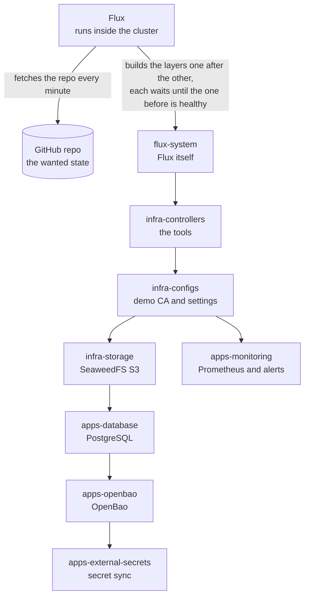
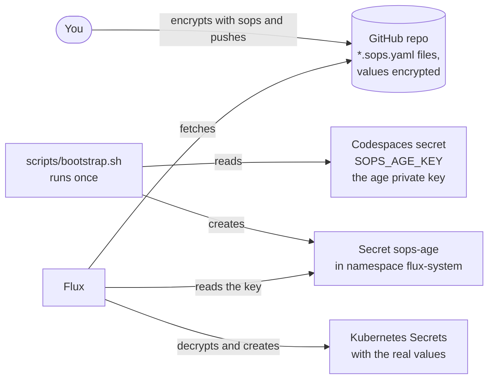
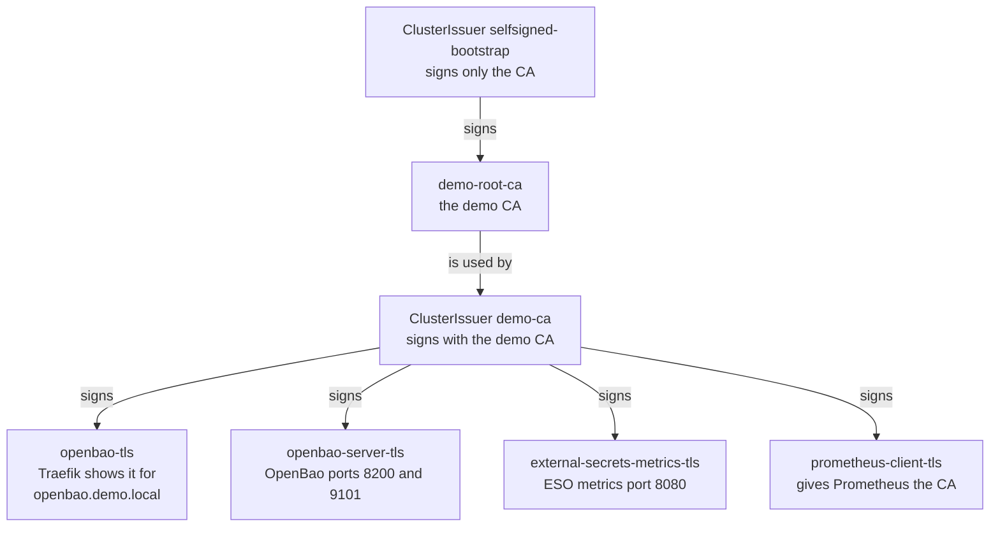
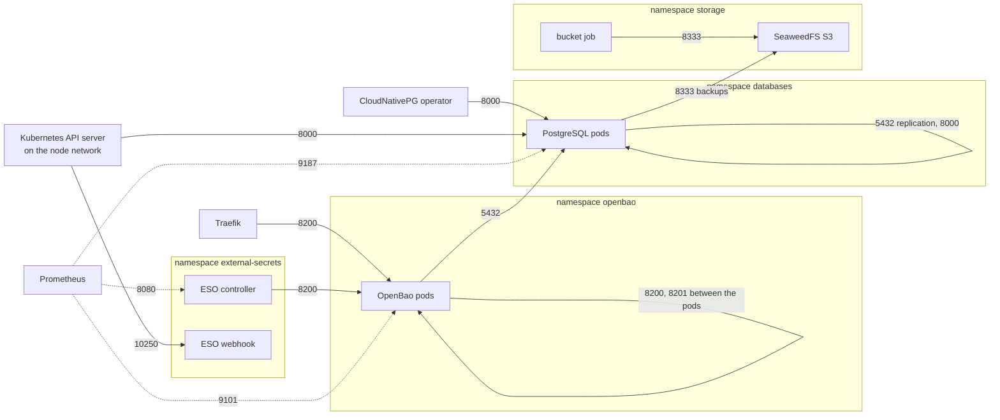

# Architecture

Details behind the README. Read the [README](../README.md) first.
Words in this file are explained in the [glossary](glossary.md).

## What it is

This file explains how the platform is built from Git, where each part lives
in the repository, and how secrets, certificates and network rules fit
together. The README shows the running platform; this file shows what is
underneath.

## Why we need it

The README is short on purpose. Without this file, a reader could not check
why a part exists, in which folder it is, or who trusts whom.

## How it gets built

How to read it: an arrow from Flux points to what Flux acts on. An arrow
between two layers means "the second layer waits until the first is healthy".
`apps-monitoring` branches off after `infra-configs`: it waits only for
`infra-controllers` and `infra-configs`, not for the database, OpenBao or
secret-sync layers.

Step by step:

1. You run `scripts/bootstrap.sh` once. It creates the kind cluster, stores
   the age key as the Secret `sops-age`, and installs Flux (`flux bootstrap`).
   This is the only manual step; everything after it comes from Git.
2. Flux fetches the repository every minute (`interval: 1m0s` in
   [`clusters/demo/flux-system/gotk-sync.yaml`](../clusters/demo/flux-system/gotk-sync.yaml)),
   so a push to `main` reaches the cluster within about a minute.
3. The layer `flux-system` applies the folder `clusters/demo/`. That folder
   holds Flux itself and the list of the other layers
   ([`infrastructure.yaml`](../clusters/demo/infrastructure.yaml),
   [`apps.yaml`](../clusters/demo/apps.yaml)).
4. `infra-controllers` installs the tools (cert-manager, Traefik,
   CloudNativePG, External Secrets Operator), because every later layer uses
   their object types.
5. `infra-configs` creates the demo CA, because later layers need
   certificates signed by it.
6. `infra-storage` starts SeaweedFS, because PostgreSQL needs a place for its
   backups.
7. `apps-database` starts PostgreSQL, because OpenBao stores its data there.
8. `apps-openbao` starts OpenBao, because ESO needs something to log in to.
9. `apps-external-secrets` creates the store and the pull and push examples.
10. `apps-monitoring` starts Prometheus as soon as the tools and the demo CA
    exist; it does not wait for steps 6 to 9.

Every layer has `wait: true`: Flux marks it Ready only when all its objects
are healthy, and only then starts the next layer.

Example: building a house. The foundation must set before the walls go up,
and the walls must stand before the roof goes on. The garden fence only needs
the plot and the surveyor's marks, so it can be built while the house is
still going up; that is `apps-monitoring`.

What can go wrong:

- A layer stays not Ready, and every layer after it waits. Check with
  `flux get kustomizations`; the MESSAGE column says which object is not
  healthy.
- A fix is pushed, but nothing changes for many minutes. Cause: the layer is
  still waiting for the old, broken version until its timeout (15 minutes for
  `apps-monitoring`); seen during monitoring stage M1
  ([`evidence/08-monitoring.txt`](evidence/08-monitoring.txt)).
- On a fresh cluster two layers wait for each other. Example avoided in
  [ADR 0007](adr/0007-monitoring.md): the ESO pod needed a certificate that
  only the next layer creates; fixed with `install.disableWait` on the ESO
  HelmRelease.

## What is where in the repo

| Folder | Flux layer | What is in it |
| --- | --- | --- |
| [`clusters/demo/`](../clusters/demo/) | `flux-system` | Flux itself (`flux-system/`) and the list of layers with their order (`infrastructure.yaml`, `apps.yaml`) |
| [`infrastructure/controllers/`](../infrastructure/controllers/) | `infra-controllers` | The tools: cert-manager, Traefik, CloudNativePG + Barman Cloud plugin, External Secrets Operator; chart sources |
| [`infrastructure/configs/`](../infrastructure/configs/) | `infra-configs` | The demo CA and its issuers, the ESO metrics certificate, one demo SOPS Secret |
| [`infrastructure/storage/`](../infrastructure/storage/) | `infra-storage` | SeaweedFS (S3), the job that creates the backup bucket, the S3 keys (SOPS) |
| [`apps/database/`](../apps/database/) | `apps-database` | The PostgreSQL cluster `pg-openbao`, backup target and schedule, the database password (SOPS) |
| [`apps/openbao/`](../apps/openbao/) | `apps-openbao` | OpenBao (Helm), its certificates, the Traefik connection settings, the database connection string (SOPS) |
| [`apps/external-secrets/`](../apps/external-secrets/) | `apps-external-secrets` | The store `openbao`, the pull and push examples in namespace `eso-demo` |
| [`apps/monitoring/`](../apps/monitoring/) | `apps-monitoring` | Prometheus stack (Helm), what to scrape (PodMonitors), the alert rules |
| [`openbao/policies/`](../openbao/policies/) | none | OpenBao policies; loaded by `scripts/openbao-configure.sh`, not by Flux |
| [`scripts/`](../scripts/) | none | Bootstrap, OpenBao init/unseal/configure, checks, failure tests ([`scripts/README.md`](../scripts/README.md)) |
| [`docs/`](./) | none | Design decisions (`adr/`), runbooks, test outputs (`evidence/`), risk assessment, time log |

NetworkPolicies sit next to the things they protect: `networkpolicy.yaml` in `infrastructure/storage/`,
`apps/database/`, `apps/openbao/` and `apps/external-secrets/`, and
`external-secrets-networkpolicy.yaml` in `infrastructure/controllers/`.

## How it runs: what the README picture leaves out

The README picture ([`images/how-it-runs.png`](images/how-it-runs.png)) shows
who calls whom while the platform runs. To keep it readable it leaves out:

- cert-manager. It does not call OpenBao. It stores the certificates as
  Secrets in the Kubernetes API (see "Certificates and who checks them" below).
- The kubelet (the Kubernetes agent on each node). Pods do not call the
  Kubernetes API for their certificates; the kubelet puts Secrets into the
  pods as files.
- The Barman Cloud plugin. The backups are sent by this plugin, which runs
  inside each PostgreSQL pod.
- Unseal, NetworkPolicies, SOPS + age and the daily backup schedule. They are
  described below and in the runbooks.

Everything runs inside one kind cluster.

## Secrets in Git: SOPS + age

What it is: a few bootstrap secrets (passwords and keys the platform needs to
start) are stored in Git, encrypted. SOPS encrypts only the values inside
files named `*.sops.yaml`; age is the encryption tool, with one key pair.

Why we need it: OpenBao cannot hand out the secrets it needs to start (its own
database password). Without SOPS these secrets would have to be typed in by
hand or stored in Git in plain text.

How to read it: an arrow points from the one who acts to what it acts on.

Step by step:

1. You encrypt a file with `sops` before you commit it. SOPS uses the age
   public key from [`.sops.yaml`](../.sops.yaml), so anyone with the repo can
   encrypt.
2. `scripts/bootstrap.sh` reads the age private key from the Codespaces
   secret `SOPS_AGE_KEY` and stores it as the Secret `sops-age` in namespace
   `flux-system`. The private key is never in Git.
3. Flux fetches the encrypted files from Git.
4. Four layers have decryption switched on (`infra-configs`,
   `infra-storage`, `apps-database`, `apps-openbao`). For them Flux reads the
   key from `sops-age`, decrypts the values and creates normal Kubernetes
   Secrets.

The five encrypted Secrets:

| File | Secret (namespace) | What it holds |
| --- | --- | --- |
| `infrastructure/configs/sops-demo.sops.yaml` | `sops-demo` (`default`) | A demo value, not used by anything |
| `infrastructure/storage/seaweedfs-s3-config.sops.yaml` | `seaweedfs-s3-config` (`storage`) | SeaweedFS's S3 users and keys (`s3.json`), also used by the bucket job |
| `infrastructure/storage/s3-credentials.sops.yaml` | `s3-credentials` (`databases`) | The S3 key PostgreSQL uses for backups |
| `apps/database/pg-openbao-openbao.sops.yaml` | `pg-openbao-openbao` (`databases`) | Password of the PostgreSQL user `openbao` |
| `apps/openbao/openbao-db.sops.yaml` | `openbao-db` (`openbao`) | OpenBao's database connection string with that password |

Example: a letter box in a front door. Anyone can push a letter through the
slot, but only the person with the key can open the box and read the
letters. The age public key is the slot; the private key in `sops-age` is the
key.

What can go wrong:

- The age private key is lost: nobody can decrypt the five Secrets any more.
  One key decrypts all of them (risk R19 in the
  [risk assessment](risk-assessment.md)).
- A new cluster without the Secret `sops-age`: the four decrypting layers
  cannot create their Secrets. Fix: run `scripts/bootstrap.sh`, which creates
  it. (Reasoning from the Flux settings; not tested.)

## Certificates and who checks them

What it is: cert-manager creates a self-signed demo CA (a certificate
authority: the one certificate that signs all others) and signs every TLS
certificate with it.

Why we need it: without certificates every connection to OpenBao would be
unencrypted, and nobody could check that they talk to the real OpenBao.

How to read it: an arrow points from the signer to what it signs.

Step by step:

1. The ClusterIssuer `selfsigned-bootstrap` signs one certificate, the CA
   `demo-root-ca` (in [`infrastructure/configs/cert-manager-issuers.yaml`](../infrastructure/configs/cert-manager-issuers.yaml)).
2. The ClusterIssuer `demo-ca` uses that CA to sign the four certificates
   above. cert-manager stores each one in a Secret of the same name.
3. Each client is given the CA (`ca.crt` from one of these Secrets) and
   checks the server's certificate against it, as the table shows.

Who checks which certificate against the demo CA:

| Connection | Who checks | How |
| --- | --- | --- |
| Browser or curl to `https://openbao.demo.local` | You | Give curl the CA (`--cacert`); a browser warns, the CA is not trusted by default |
| Traefik to OpenBao (port 8200) | Traefik | `ServersTransport` with the demo CA and the name `openbao-active.openbao.svc` |
| ESO to OpenBao (port 8200) | ESO | `caProvider` in the store, CA from `openbao-server-tls` |
| Prometheus to OpenBao (9101) and ESO (8080) | Prometheus | CA from `prometheus-client-tls`, fixed server names, never skipped |
| OpenBao to PostgreSQL (5432) | nobody | Encrypted (`sslmode=require`) but not checked (risk R15); PostgreSQL uses CloudNativePG's own CA |
| Prometheus to PostgreSQL metrics (9187) | nobody | Plain HTTP (known gap, risk R30) |

Example: a passport. A government issues it, and a border officer accepts it
because the officer trusts that government's stamp. The demo CA is the
government; every client that was given `ca.crt` is a border officer who
trusts it.

What can go wrong:

- curl fails with a certificate error for `openbao.demo.local`: it was not
  given the CA. Use `--cacert` with `ca.crt` from the Secret `openbao-tls`.
- A certificate is renewed, but OpenBao still serves the old one: OpenBao
  reads its certificate only at start, so the pods must be restarted one by
  one (risk R12, runbook [openbao-init-unseal.md](runbooks/openbao-init-unseal.md)).
- Prometheus shows the ESO target down with a certificate error: the ESO
  controller fell back to a self-signed certificate (see
  [ADR 0007](adr/0007-monitoring.md) and [operations](operations.md)).

## Network rules (NetworkPolicies)

What it is: a NetworkPolicy is a Kubernetes rule that says which pods may
connect to which pods, on which port. In five namespaces every incoming
connection is blocked unless a rule allows it: `storage`, `databases`,
`openbao`, `external-secrets`, `eso-demo`.

Why we need it: without these rules any pod in the cluster could connect to
OpenBao, PostgreSQL or the backup storage (risk R10). Outgoing connections
are not limited. The other namespaces have no rules.

How to read it: an arrow points from the one who connects to the one who
accepts; the label is the allowed port. Nothing else may connect into these
namespaces.

Step by step (what each rule allows, and why):

1. `default-deny-ingress` in each of the five namespaces blocks everything
   coming in, so a new pod starts closed.
2. OpenBao (8200) accepts Traefik (the HTTPS entry point), the ESO
   controller (to sync secrets) and the other OpenBao pods; 8201 is
   OpenBao's cluster port, where standbys forward requests to the active pod.
3. PostgreSQL (5432) accepts OpenBao (its data) and the other PostgreSQL
   instances (replication). Port 8000 is CloudNativePG's instance manager
   (status and control of each PostgreSQL pod); it accepts the operator, the
   other instances and the Kubernetes API server (for `kubectl cnpg status`).
4. SeaweedFS (8333) accepts the PostgreSQL pods (backups) and the bucket job.
5. The ESO webhook (10250) accepts the Kubernetes API server, which asks it
   to check every new ESO object.
6. The metrics ports (9101, 9187, 8080) accept only the Prometheus pod.
7. Namespace `eso-demo` has no pods, so it has no allow rules.

The rules live in the `networkpolicy.yaml` files listed in "What is where in
the repo"; tested with `scripts/netpol-*.sh` (evidence in
[`evidence/06-hardening.txt`](evidence/06-hardening.txt)).

Example: an office building where every door is locked. Each room has a
short list on the door saying whose badge may open it. Anyone not on the
list stays outside, even if they are already in the building.

What can go wrong:

- `kubectl cnpg status` hangs: the API server comes from the kind node
  network, whose address range can change when the cluster is rebuilt (was
  172.18, then 172.19). The rule therefore allows all of `172.16.0.0/12`
  (see the comments in [`apps/database/networkpolicy.yaml`](../apps/database/networkpolicy.yaml)).
- A restore cluster hangs: before failure test F6 the rule for port 8000
  covered only `pg-openbao`; it now covers every CloudNativePG instance
  (`cnpg.io/podRole: instance`).
- A new pod in one of the five namespaces cannot be reached: that is the
  default-deny rule working. Add an allow rule next to the others.

## Components and versions

| Component | Purpose | Version |
| --- | --- | --- |
| kind | Local multi-node Kubernetes cluster | v0.33.0 |
| kind node image | Kubernetes inside each node container | `kindest/node:v1.37.0` (Kubernetes 1.37.0, kind v0.33.0 default) |
| Flux | GitOps engine | v2.9.6 |
| SOPS | Encrypted bootstrap secrets in Git | 3.13.3 |
| age | Key for SOPS | 1.1.1 (Ubuntu package) |
| cert-manager | TLS certificates (self-signed CA) | v1.21.3 |
| Traefik | HTTPS entry point (ingress) | chart 42.1.3 |
| SeaweedFS | In-cluster S3 for PostgreSQL backups | 4.48 (image) |
| CloudNativePG | HA PostgreSQL with backups | operator 1.30.1 (chart 0.29.1), PostgreSQL 18.6, plugin-barman-cloud 0.15.1 (chart 0.8.1) |
| OpenBao | Secrets management (HA, PostgreSQL backend) | 2.7.1 (chart 0.30.4) |
| External Secrets Operator | Secret sync OpenBao <-> Kubernetes | 2.14.0 (chart and app) |
| kube-prometheus-stack | Metrics and alerts: Prometheus, Alertmanager, Prometheus Operator, kube-state-metrics | chart 92.3.1 (Prometheus v3.15.0, Alertmanager v0.34.1, operator v0.94.1, kube-state-metrics 2.20.0) |

## Design decisions

All decisions are in [`adr/`](adr/):

- [ADR 0001](adr/0001-pinned-versions.md): pin exact chart and image versions.
- [ADR 0002](adr/0002-in-cluster-s3.md): in-cluster S3 with SeaweedFS for PostgreSQL backups.
- [ADR 0003](adr/0003-cloudnativepg-ha.md): HA PostgreSQL with CloudNativePG, backups through the Barman Cloud plugin.
- [ADR 0004](adr/0004-openbao-ha-postgresql.md): OpenBao HA on PostgreSQL, manual Shamir unseal, TLS at Traefik.
- [ADR 0005](adr/0005-external-secrets-openbao.md): External Secrets with one ClusterSecretStore, TLS on the OpenBao listener, Kubernetes auth, push/pull policies.
- [ADR 0007](adr/0007-monitoring.md): monitoring with kube-prometheus-stack, metrics over verified TLS (OpenBao, ESO; PostgreSQL plain HTTP as a known gap), alert rules.

## Words used

S3 is a common way to store files over HTTP; SeaweedFS provides it inside the
cluster. WAL (write-ahead log) is PostgreSQL's running record of every change;
with the backups it allows a restore to any point in time. A service account
is the identity a pod has in Kubernetes. More words: [glossary](glossary.md).

## Other diagrams

- How it runs (who calls whom): [README](../README.md#in-60-seconds)
- Starting and unsealing OpenBao: [runbooks/openbao-init-unseal.md](runbooks/openbao-init-unseal.md#the-picture-starting-and-unsealing-openbao)
- How one sync works (ESO login, pull, push): [runbooks/external-secrets.md](runbooks/external-secrets.md#the-picture-how-one-sync-works)
- Backup and restore: [runbooks/postgres-backup-restore.md](runbooks/postgres-backup-restore.md#the-picture-backup-and-restore)
