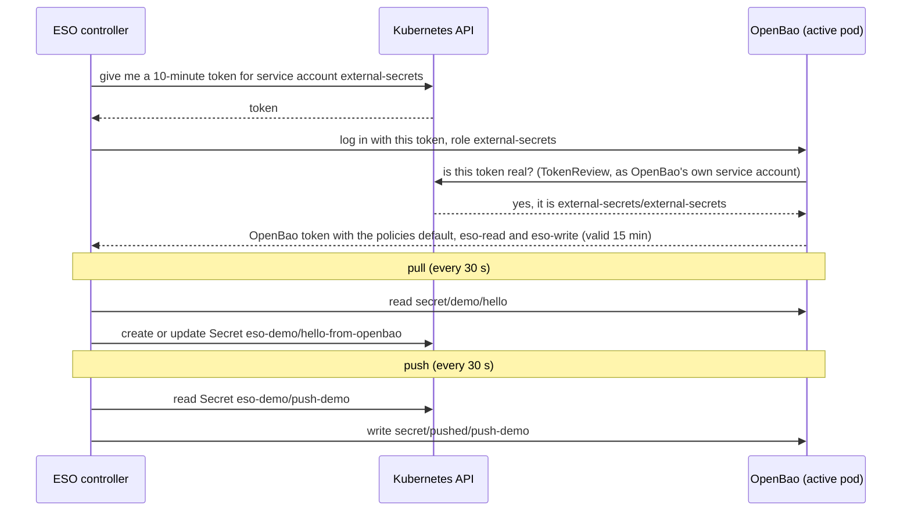

# Runbook: External Secrets with OpenBao

## What it is

External Secrets Operator (ESO) copies secrets between OpenBao and
Kubernetes, in both directions. An ExternalSecret copies a value from OpenBao
into a Kubernetes Secret (pull); a PushSecret copies a Kubernetes Secret into
OpenBao (push).

External Secrets Operator (namespace `external-secrets`) syncs between OpenBao
and Kubernetes through the ClusterSecretStore `openbao` (Flux layer
`apps-external-secrets`, folder `apps/external-secrets/`). Design:
[ADR 0005](../adr/0005-external-secrets-openbao.md). Tested on 2026-10-26,
evidence in `docs/evidence/05-*.txt`.
Words are explained in the [glossary](../glossary.md).

## Why we need it

Apps in Kubernetes read normal Kubernetes Secrets, not OpenBao. Without ESO
someone would have to copy every value by hand, and a changed value in
OpenBao would never reach the app.

## The picture: how one sync works

How one sync works, step by step (the ESO controller logs in again for every sync):



How to read it: time runs from top to bottom. A solid arrow is a call, a dashed
arrow is its answer.

Words in the picture: a service account is the identity a pod has in
Kubernetes. TokenRequest is the API call that gives a short-lived token for
it; TokenReview is the call that answers "is this token real, and whose is
it?".

## How it is set up

External Secrets Operator (chart 2.14.0) connects to OpenBao through one
`ClusterSecretStore` `openbao`: HTTPS to `openbao-active.openbao.svc:8200`
(listener certificate from the demo CA), login with Kubernetes auth as service
account `external-secrets/external-secrets` (role `external-secrets`,
policies in [`openbao/policies/`](../../openbao/policies/)). No root or static token.
Manifests: [`apps/external-secrets/`](../../apps/external-secrets/), layer
`apps-external-secrets`.

- **Pull**: `ExternalSecret eso-demo/hello` copies `secret/demo/hello` (field
  `message`) to the Secret `eso-demo/hello-from-openbao` every 30 s.
- **Push**: `PushSecret eso-demo/push-demo` copies the demo Secret
  `eso-demo/push-demo` to `secret/pushed/push-demo` (`updatePolicy: Replace`,
  `deletionPolicy: Delete`).
- **Least privilege**: the ESO login can read `secret/`, write only below
  `secret/pushed/`; the refresh test changes values with a separate
  `demo-writer` login.

Objects:
- `ClusterSecretStore/openbao`: where OpenBao is
  (`https://openbao-active.openbao.svc:8200`), which CA to trust, how to log in
  (Kubernetes auth, role `external-secrets`). Only namespace `eso-demo` may use it.
- `ExternalSecret eso-demo/hello` (pull): `secret/demo/hello` field `message`
  -> Secret `eso-demo/hello-from-openbao`, every 30 s.
- `PushSecret eso-demo/push-demo` (push): Secret `eso-demo/push-demo` key
  `message` -> `secret/pushed/push-demo`.

## Step by step

### 1. Check the store

```bash
kubectl get clustersecretstore openbao
bash scripts/eso-store-check.sh      # also reconciles Flux and shows conditions
```

Expected: `STATUS Valid`, `READY True`, message `store validated`.

If not, the condition message names the failing link:

| Message contains | Meaning | Fix |
| --- | --- | --- |
| `connection refused`, `503`, `sealed` | OpenBao sealed or down | `bash scripts/openbao-unseal.sh` |
| `x509: certificate signed by unknown authority` | wrong CA | `caProvider` must point at `openbao/openbao-server-tls`, key `ca.crt` |
| `x509: certificate is valid for ..., not ...` | name not in the certificate | `server` must use a name from `apps/openbao/server-certificate.yaml` |
| `permission denied` on `auth/kubernetes/login` | role / service account mismatch | role `external-secrets` must bind `external-secrets/external-secrets` (`scripts/openbao-configure.sh`) |
| `service account ... not found` | `serviceAccountRef` wrong | name and namespace in `clustersecretstore.yaml` |

### 2. Debug a failing ExternalSecret or PushSecret

```bash
bash scripts/eso-debug.sh externalsecret hello
bash scripts/eso-debug.sh pushsecret push-demo
```

It shows the object's conditions, its events, the store status and the last
ESO log lines for that object (ESO logs paths and errors, not values).
Then:

- **`403` / `permission denied` with a URL**: the OpenBao policy does not allow
  that path and operation. The URL shows which: `GET .../secret/data/...` =
  `read`, `PUT/POST` = `create`/`update`, `DELETE` = `delete`,
  `.../secret/metadata/...` = metadata rules. Remember: OpenBao uses only the
  **most specific** matching path pattern, it does not combine
  `secret/data/*` with `secret/data/pushed/*`. Fix the file in
  `openbao/policies/`, commit, run `bash scripts/openbao-policy-update.sh`.
- **Message that the secret or key was not found** (wording varies): the key
  does not exist in OpenBao (`remoteRef.key` is relative to the mount: `demo/hello`,
  not `secret/data/demo/hello`), or the `property` does not exist.
- **Message about the namespace or the store's conditions** (wording not verified): the
  ExternalSecret is in a namespace not listed in the store's `conditions`.
- **PushSecret `secret not managed by external-secrets`**: a value already
  exists at the target path without ESO's marker; ESO refuses to overwrite it
  on purpose. Choose another `remoteKey` or remove the existing value by hand.
- Nothing in the logs and status `SecretSynced`, but the value is old: wait one
  refresh interval (30 s). To force a sync now:
  `kubectl -n eso-demo annotate externalsecret hello force-sync=$(date +%s) --overwrite`
  (an annotation change triggers a reconcile; it is not a lasting change).

### 3. Prove it end to end

```bash
bash scripts/eso-pull-check.sh       # pulled value = hello-from-openbao
bash scripts/eso-refresh-test.sh     # change as demo-writer, wait, restore
bash scripts/eso-push-check.sh       # pushed value read back as the ESO login
bash scripts/eso-evidence.sh         # everything incl. least privilege -> docs/evidence/05-external-secrets.txt
```

### 4. After a Codespace restart

OpenBao comes back sealed, so the store and the layer `apps-external-secrets`
turn `False`; existing Kubernetes Secrets stay as they are.
Measured: in failure test F3 (sealed about 2 minutes) the store still showed
`Valid` while the ExternalSecret failed after about 90 s; in the monitoring
re-run of F3 the store turned `False InvalidProviderConfig` after 142 s sealed
([`08-monitoring.txt`](../evidence/08-monitoring.txt), risk R11).

```bash
bash scripts/resume.sh
bash scripts/openbao-unseal.sh
kubectl get clustersecretstore openbao   # back to Valid / True within about a minute
```

### 5. Certificate renewal of the OpenBao listener

cert-manager renews `openbao-server-tls` 15 days before it expires (90 days).
OpenBao keeps serving the certificate it loaded at start, so restart the pods
one by one after a renewal (standbys first) and unseal each:
see [openbao-init-unseal.md](openbao-init-unseal.md), section 4. Check the
dates with
`kubectl -n openbao get certificate openbao-server-tls -o jsonpath='{.status.notAfter} {.status.renewalTime}{"\n"}'`.

### 6. Add a new app secret (production pattern)

1. Store the value in OpenBao under a path the app's store may read (by a
   person or CI with its own login, never root).
2. Add an `ExternalSecret` in the app's namespace (the namespace must be in the
   store's `conditions`) with `secretStoreRef` `ClusterSecretStore/openbao`.
3. Commit; Flux applies it; check with `bash scripts/eso-debug.sh externalsecret <name>`.

## Example

A hotel guest card. At the front desk you show your passport (the service
account token) and get a key card (the OpenBao token) that opens only your
floor (the policies). The card stops working after a while (15 minutes), so
the guest comes back to the desk for every visit, as ESO logs in again for
every sync.

## What can go wrong

- Store not `Valid`, message contains `sealed` or `503`: OpenBao is sealed.
  Fix: `bash scripts/openbao-unseal.sh` (section 1).
- ExternalSecret not Ready with `403` / `permission denied`: the policy does
  not allow that path; OpenBao uses only the most specific matching pattern.
  Fix the file in `openbao/policies/`, then
  `bash scripts/openbao-policy-update.sh` (section 2).
- PushSecret fails with `secret not managed by external-secrets`: a value
  without ESO's marker already exists at that path (section 2).
- Deleting a PushSecret deletes the value and all versions in OpenBao
  (`deletionPolicy: Delete`, failure test F4, risk R21).
