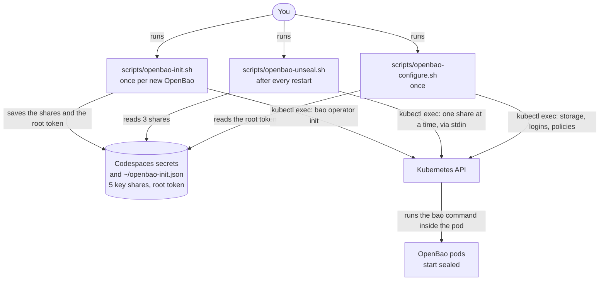

# Runbook: OpenBao init, unseal and recovery

OpenBao runs as StatefulSet `openbao/openbao` (3 pods, one active, two
standby) with all data in PostgreSQL `databases/pg-openbao`. Design:
[ADR 0004](../adr/0004-openbao-ha-postgresql.md). Tested on 2026-10-26,
evidence in `docs/evidence/04-*.txt`.

Every OpenBao pod starts sealed: it runs but cannot read its own data until 3 of
the 5 key shares are entered. This runbook covers the first start, the unseal
after every restart, and recovery when a pod, a key or the root token is lost.
Words are explained in the [glossary](../glossary.md).

## How init and unseal work



How to read it: an arrow points from the one who starts the call to the one who
is asked. The scripts never call OpenBao over the network; they run the `bao`
command inside a pod through `kubectl exec`, and pass keys and tokens through
stdin, never on the screen or the command line. `openbao-configure.sh` sets up
the secret storage (KV v2), the Kubernetes login for ESO, and the policies in
[`openbao/policies/`](../../openbao/policies/).

Terms:
- Sealed: the pod is running but cannot decrypt anything; it answers only
  status and unseal requests. Every pod starts sealed.
- Key shares: the key that unlocks OpenBao's encryption key is split into
  5 shares; any 3 unseal a pod (`Total Shares 5`, `Threshold 3`). It works like
  a bank vault with five managers: any three of their keys open it, one or two
  open nothing.
- Active / standby: the pod holding the lock row in `openbao_ha_locks` is
  active and serves requests; standbys wait to take over.

Where the secrets are (never in Git, never printed):
- `~/openbao-init.json` in the Codespace (`chmod 600`), plus your own copy
  outside the Codespace.
- Codespaces secrets `OPENBAO_UNSEAL_KEYS` (JSON list of the 5 shares) and
  `OPENBAO_ROOT_TOKEN`; they appear as environment variables in a new or
  restarted Codespace.

## 1. First start (once per new OpenBao, i.e. empty database)

```bash
bash scripts/openbao-deploy-check.sh   # 3 pods Running 0/1, Initialized false
bash scripts/openbao-init.sh           # "initialised, keys saved to ..."
bash scripts/openbao-unseal.sh         # all pods unsealed, 1 active, 2 standby
bash scripts/openbao-configure.sh      # KV v2, Kubernetes auth, policies, role
```

`openbao-init.sh` refuses to run if `~/openbao-init.json` exists or the pod
reports `initialized=true`. Download `~/openbao-init.json` (Explorer, right
click, Download) and keep it somewhere safe outside the Codespace.

## 2. After a restart (Codespace, node or all pods)

```bash
bash scripts/resume.sh                 # Codespace only: nodes back
kubectl -n openbao get pods            # wait for 3 x Running (0/1 = sealed)
bash scripts/openbao-unseal.sh
```

Expected: `openbao-N: unsealed` for each sealed pod, then all `1/1` and one
`HA Mode active`. The script is safe to repeat; unsealed pods are skipped.

## 3. One pod fails or is deleted

Nothing to do for the service: if it was the active pod, a standby takes the
lock within seconds (measured: about 7 s). The StatefulSet recreates the pod;
it comes back sealed (`0/1`, label `openbao-sealed=true`). Unseal it:

```bash
kubectl -n openbao get pods -L openbao-active,openbao-sealed
bash scripts/openbao-unseal.sh
```

Test again any time with `bash scripts/failure-tests/openbao-failover-test.sh` (deletes the
active pod, asks first).

If a pod stays `Pending` after a node failure: required anti-affinity allows
one pod per worker, so it waits until the worker is back. OpenBao keeps
running with the other pods.

## 4. Config change from Git

The chart uses `updateStrategy: OnDelete`: Flux updates the StatefulSet, but
running pods keep the old config until deleted. Roll it by hand, standbys
first, one at a time:

```bash
kubectl -n openbao get pods -L openbao-active
kubectl -n openbao delete pod <standby>   # wait until Running
bash scripts/openbao-unseal.sh            # repeat for the other standby
kubectl -n openbao delete pod <active>    # a standby takes over
bash scripts/openbao-unseal.sh
```

The same applies after rotating the database password
(`bash scripts/openbao-db-secret.sh --force`, commit, push): the pods only read
`BAO_PG_CONNECTION_URL` at start. CloudNativePG changes the role's password
right away, so restart all OpenBao pods promptly after Flux applied it.

The same again after cert-manager renewed the listener certificate
`openbao-server-tls` (90 days, renewed 15 days before expiry): OpenBao only
loads it at start. `bash scripts/openbao-tls-rollout.sh` only restarts pods on
an old StatefulSet revision, so after a renewal delete the pods by hand as
above.

## 5. Lost keys

- Fewer than 3 shares left (file, copy and Codespaces secrets lost): the
  data in PostgreSQL **cannot be decrypted by anyone**. Backups of
  `pg-openbao` do not help: they contain the same encrypted data. The only way
  forward is a new, empty OpenBao: drop and recreate the tables (or a new
  database), run section 1, and recreate every secret from its source. (risk R02)
- 3 or more shares left: everything works. Make new shares at once with
  `bao operator rekey` (needs 3 current shares) and store them again.
- Root token lost: not a problem; create a new one with a quorum of shares
  (section 6).
- Key shares leaked: rekey (`bao operator rekey`) so the old shares become
  useless; the encryption key itself can be rotated with `bao operator rotate`.

## 6. Revoke and generate the root token

The root token can do everything and is not needed for daily operation
(unseal needs only key shares; ESO uses Kubernetes auth). Scripts that need it:
`openbao-configure.sh`, `openbao-policy-update.sh`, and the audit device list
in `openbao-audit-check.sh`.

Revoke (asks first; token through stdin; checks that the token is refused
afterwards; offers to delete the Codespaces secret):

```bash
bash scripts/openbao-revoke-root.sh
```

Expected: `Success! Revoked token`, then `refused (expected): the root token
is revoked`. The `root_token` in `~/openbao-init.json` and in your downloaded
copy is then useless; keep the file for the unseal keys.

Generate a new root token when needed (needs 3 of the 5 key shares;
**untested**, written from the OpenBao v2.7.1 CLI source):

```bash
bash scripts/openbao-generate-root.sh   # stores it as Codespaces secret OPENBAO_ROOT_TOKEN
# restart the Codespace so the new secret appears as an environment variable,
# do the work, then:
bash scripts/openbao-revoke-root.sh
```

What the script does, step by step (the same commands work by hand inside the
active pod):

1. `bao operator generate-root -generate-otp`: a one-time password (OTP).
2. `bao operator generate-root -init -otp=<OTP>`: starts the procedure and
   returns a `nonce` (an ID for this attempt).
3. Three times: `bao operator generate-root -nonce=<nonce> -` with one key
   share on stdin (`-` means "read from stdin"; without it the CLI prompts on a
   terminal and fails when input is piped). Progress goes 1/3, 2/3, 3/3; the
   last answer contains `encoded_token`.
4. `bao operator generate-root -decode=- -otp=<OTP>` with the encoded token on
   stdin prints the new root token (the script sends it straight to
   `gh secret set`, never to the screen).
5. A started attempt that is not finished blocks new attempts; cancel it with
   `bao operator generate-root -cancel`.

## 7. Reach the UI

HTTPS through Traefik from inside the Codespace:

```bash
kubectl -n openbao get secret openbao-tls -o jsonpath='{.data.ca\.crt}' | base64 -d > /tmp/openbao-ca.crt
curl --resolve openbao.demo.local:443:127.0.0.1 --cacert /tmp/openbao-ca.crt \
  https://openbao.demo.local/v1/sys/health
```

From your browser (fallback, tunnel to the pod; since ADR 0005 the listener
itself speaks HTTPS with a certificate for `localhost`, signed by the demo CA,
so the browser warns unless it trusts that CA):

```bash
kubectl -n openbao port-forward svc/openbao-active 8200:8200
```

Codespaces offers to open forwarded port 8200 (use `https://`); add `/ui` to the URL. Logging
in needs a token; for the demo, log in only to show the UI and do not keep a
root token around for it.

## 8. Restore of PostgreSQL and OpenBao

A point-in-time restore of `pg-openbao` (see
[postgres-backup-restore.md](postgres-backup-restore.md)) brings back
OpenBao's encrypted data as of that time; the same unseal keys still work
(they belong to the data). If OpenBao should use a restored cluster, set
`bootstrap.recovery.secret.name: pg-openbao-openbao` in the restore manifest so
the role `openbao` gets the password OpenBao knows, point the connection URL at
the new cluster's `-rw` Service, restart the OpenBao pods and unseal them.
