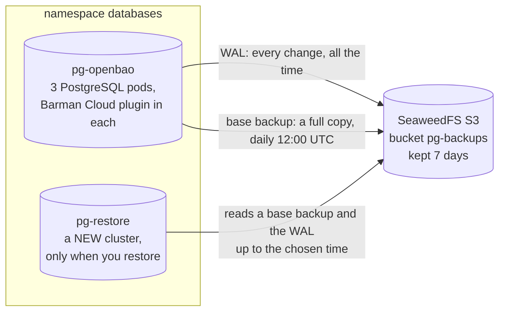

# Runbook: PostgreSQL backup and point-in-time restore

Cluster `databases/pg-openbao` (CloudNativePG) archives WAL continuously and
takes a daily base backup through the Barman Cloud plugin into
`s3://pg-backups/pg-openbao/` (ObjectStore `databases/pg-backups`, SeaweedFS).
Design: [ADR 0003](../adr/0003-cloudnativepg-ha.md), [ADR 0002](../adr/0002-in-cluster-s3.md).
Tested on 2026-10-25, evidence in `docs/evidence/03-*.txt`.
Words are explained in the [glossary](../glossary.md).

If the data in PostgreSQL is lost, every secret in OpenBao is lost with it.
The backups live in SeaweedFS inside the same cluster, so losing the
Codespace loses the data and its backups together (risk R05).

## How backup and restore work



How to read it: an arrow points from the pod that starts the call to the one
that is asked. The live cluster only writes to S3; a restore cluster only
reads from it (it has no WAL archiving of its own, so it can never overwrite
the live cluster's backups). Example restore cluster:
[`restore-example.yaml`](restore-example.yaml).

Terms:
- Base backup: full copy of the database files at one moment (`base/<id>/data.tar.gz`).
- WAL: the log of every change, in 16 MB files (`wals/<timeline>/<file>.gz`).
- Point-in-time recovery (PITR): restore the newest base backup before the
  target time, then replay WAL up to the target time. Think of a photo of a
  room taken every day at noon and a diary of every change: to see the room at
  15:30 yesterday, take yesterday's noon photo and redo the diary up to 15:30.
- Timeline: a number PostgreSQL increases at every promotion or PITR, so WAL
  histories that branched off each other are not mixed (`0000000N.history`).

## How it is set up

- The `ScheduledBackup` `pg-openbao-daily` takes a base backup every day at
  12:00 UTC (13:00 Berlin in winter), cron `"0 0 12 * * *"`
  ([`apps/database/backups.yaml`](../../apps/database/backups.yaml)). A slot missed
  while the Codespace is stopped runs as soon as the cluster runs again.
- Backups go through the Barman Cloud plugin to `s3://pg-backups/` on
  SeaweedFS; WAL is archived continuously; retention 7 days
  ([`apps/database/objectstore.yaml`](../../apps/database/objectstore.yaml)).
- Point-in-time recovery always goes into a **new** cluster, never over the
  live one. The steps are in section 4 below.

```bash
bash scripts/failure-f6-restore.sh                                # tested PITR into a temporary cluster
kubectl -n databases get backups --sort-by=.metadata.creationTimestamp
```

A restore cluster needs NetworkPolicy access for the CloudNativePG operator to
its instance manager (port 8000): `allow-instance-manager` in
[`apps/database/networkpolicy.yaml`](../../apps/database/networkpolicy.yaml) now
selects every CloudNativePG instance (`cnpg.io/podRole: instance`), not only
`pg-openbao`.

## 1. Check backup health

```bash
kubectl cnpg status pg-openbao -n databases
kubectl -n databases get backup,scheduledbackup
```

Expected, in section "Continuous Backup status":

```
Working WAL archiving:          OK
WALs waiting to be archived:    0
First Point of Recoverability:  <oldest time you can restore to>
Last Successful Backup:         <less than ~24h ago>
```

and every Backup with `PHASE completed`. You can restore to any time between
First Point of Recoverability and the Last Archived WAL time.

`Last Failed WAL: 0000000N.history` right after a failover is harmless: during
promotion PostgreSQL first *looks up* the new timeline's history file in the
archive and expects "does not exist". Confirm the file was then archived:
`wals/0000000N.history.gz` in the bucket (step 3).

## 2. Take an on-demand base backup

Before risky changes (upgrades, migrations):

```bash
kubectl cnpg backup pg-openbao -n databases \
  --method=plugin --plugin-name=barman-cloud.cloudnative-pg.io
kubectl -n databases get backup -w
```

Expected: a new Backup `pg-openbao-<timestamp>` that goes to `PHASE completed`
(about 15 s for a small database). This creates a Backup object outside Git;
that is fine, it is a record of an action, not configuration.

## 3. Look into the bucket

From a temporary pod with the AWS CLI and the PostgreSQL S3 credentials
(delete it afterwards):

```bash
kubectl -n databases run s3-list --restart=Never --image=amazon/aws-cli:2.37.13 \
  --overrides='{"spec":{"containers":[{"name":"aws","image":"amazon/aws-cli:2.37.13",
  "args":["--endpoint-url","http://seaweedfs.storage.svc:8333","s3","ls","s3://pg-backups/","--recursive"],
  "env":[{"name":"AWS_DEFAULT_REGION","value":"us-east-1"},
  {"name":"AWS_ACCESS_KEY_ID","valueFrom":{"secretKeyRef":{"name":"s3-credentials","key":"ACCESS_KEY_ID"}}},
  {"name":"AWS_SECRET_ACCESS_KEY","valueFrom":{"secretKeyRef":{"name":"s3-credentials","key":"ACCESS_SECRET_KEY"}}}]}]}}'
kubectl -n databases logs s3-list
kubectl -n databases delete pod s3-list
```

Expected: `pg-openbao/base/<id>/backup.info`, `pg-openbao/base/<id>/data.tar.gz`
and a continuous series of `pg-openbao/wals/.../*.gz`.

## 4. Point-in-time restore into a new cluster (tested)

This restores into a **new** cluster `pg-restore` next to the running one, to
inspect or recover data. The source cluster is not touched.

1. Choose the target time (UTC, RFC3339, e.g. `2026-10-25T12:53:36Z`). It
   must be after "First Point of Recoverability" (step 1).
2. If the source is still running, make sure the WAL up to the target time
   is archived: force a WAL file switch, then check step 1 again
   (`WALs waiting to be archived: 0`, Last Archived WAL time after the target):

   ```bash
   P=$(kubectl -n databases get cluster pg-openbao -o jsonpath='{.status.currentPrimary}')
   kubectl -n databases exec $P -c postgres -- psql -c "SELECT pg_switch_wal();"
   ```

   Without this, changes from the last few minutes may still be only in the
   current WAL file (`archive_timeout` is 5 minutes).
3. Set the target in `docs/runbooks/restore-example.yaml`
   (`spec.bootstrap.recovery.recoveryTarget.targetTime`). This file is not in a
   Flux path, so Flux never creates it by itself.
4. Apply it by hand and follow the recovery job (its log is deleted with the
   job after success, so watch it live if you want to keep it):

   ```bash
   kubectl apply -f docs/runbooks/restore-example.yaml
   kubectl -n databases get pods -w            # pg-restore-1-full-recovery-..., then pg-restore-1
   kubectl -n databases logs -f job/pg-restore-1-full-recovery   # optional, while it runs
   kubectl -n databases get cluster pg-restore
   ```

   Expected after about 1-2 minutes: `pg-restore  1  1  Cluster in healthy state`.
5. Verify the data:

   ```bash
   kubectl -n databases exec pg-restore-1 -c postgres -- psql -d openbao -c "SELECT ..."
   kubectl -n databases exec pg-restore-1 -c postgres -- \
     psql -c "SELECT timeline_id FROM pg_control_checkpoint();"
   ```

   Expected: data up to the target time, nothing after it; a timeline number
   one higher than the source's.
6. Clean up when done (deletes the pod, its PVC and its Secrets; S3 and
   `pg-openbao` are not touched):

   ```bash
   kubectl delete -f docs/runbooks/restore-example.yaml
   kubectl -n databases get cluster,pods,pvc   # only pg-openbao-* left
   ```

The restored cluster has **no WAL archiving** on purpose: it must never write
into `s3://pg-backups/pg-openbao/`, which belongs to the source cluster.

## 5. Replace production with a restore (not tested)

Outline only; to be tested once OpenBao uses the database.

1. Stop writers (scale OpenBao to 0) so no new data is written.
2. Restore as in step 4, with `instances: 3`, the same `affinity` as
   `pg-openbao`, and a `plugins` entry for WAL archiving with a **new**
   `serverName` parameter (e.g. `pg-openbao-r1`), so the new cluster archives to
   its own folder.
3. Make the change in Git (Flux): either point OpenBao at the new cluster's
   `-rw` Service and Secret, or replace `apps/database/cluster.yaml` with the
   recovery bootstrap under the original name after deleting the old cluster.
4. Take an on-demand backup of the new cluster (step 2) and start OpenBao.

## Troubleshooting

| Symptom | Likely cause | Check / fix |
| --- | --- | --- |
| `Working WAL archiving: Failing` | S3 unreachable or wrong credentials | `kubectl -n storage get pods`; plugin log: `kubectl -n databases logs <primary> -c plugin-barman-cloud` |
| `x-amz-content-sha256` / checksum errors in plugin log | newer boto3 checksum defaults vs. S3-compatible server | add `AWS_REQUEST_CHECKSUM_CALCULATION=when_required` and `AWS_RESPONSE_CHECKSUM_VALIDATION=when_required` to `instanceSidecarConfiguration.env` of the ObjectStore (plugin docs) |
| Backup stays without phase | cluster not ready yet | it starts once the primary is up (seen at creation) |
| A PostgreSQL pod stays `Pending` | `required` anti-affinity and no free worker (e.g. a node is down) | expected; the cluster runs on the remaining instances until a node is back |
| Restore stops with "recovery ended before configured recovery target was reached" | WAL up to the target is not archived | do step 4.2 on the source, or pick an earlier target |
